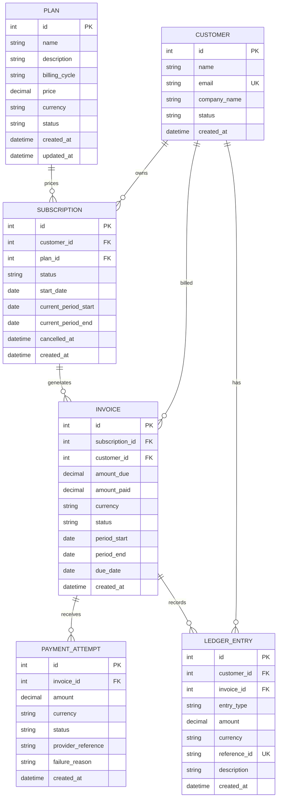
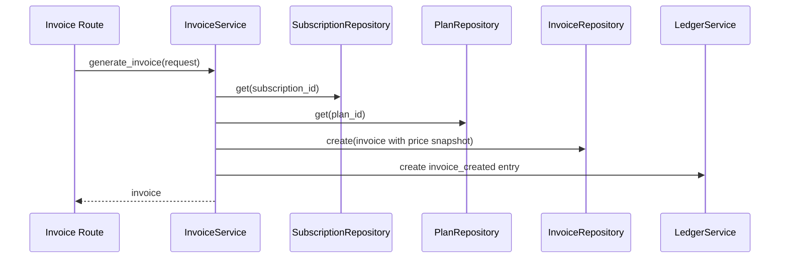

# SubLedger Low-Level Design

## 1. Scope

SubLedger is a learning-oriented billing backend. It manages plans, customers, subscriptions, invoices, payment attempts, and ledger events. Payment outcomes are simulated by an API request; there is no real gateway integration.

## 2. ERD



## 3. Layer responsibilities

| Layer | Location | Responsibility |
|---|---|---|
| Routes/controllers | `app/routes/` | Define HTTP methods, paths, request/response schemas, and call services. No business rules. |
| Services | `app/services/` | Own workflows and business rules, coordinate repositories, and commit complete write operations. |
| Repositories | `app/repositories/` | Read/write SQLAlchemy entities. No pricing or billing decisions. |
| Models | `app/models.py` | Define tables, columns, constraints, and ORM relationships. |
| Schemas | `app/schemas.py` | Validate request shape/types and define response contracts. |
| Database/config | `app/db.py`, `app/config.py` | Create engine/session and load `DATABASE_URL`. |
| Dependency wiring | `app/dependencies.py` | Connect a request-scoped database session to repositories and services. |
| Domain errors | `app/exceptions.py`, `app/main.py` | Translate expected service errors to HTTP statuses. |

## 4. Repository responsibilities

| Repository | Entity | Common methods | Responsibility |
|---|---|---|---|
| `PlanRepository` | `Plan` | `create`, `get`, `list_all`, `update` | Persist and retrieve plans. |
| `CustomerRepository` | `Customer` | `create`, `get`, `get_by_email`, `list_all` | Persist and retrieve customers, including lookup by email. |
| `SubscriptionRepository` | `Subscription` | `create`, `get`, `list_all`, `has_active_for_customer_plan` | Persist and retrieve subscriptions and query for an active customer/plan pair. |
| `InvoiceRepository` | `Invoice` | `create`, `get` | Persist and retrieve invoices. |
| `PaymentAttemptRepository` | `PaymentAttempt` | `create`, `list_for_invoice` | Persist payment attempts and list attempts for an invoice. |
| `LedgerRepository` | `LedgerEntry` | `create`, `list_for_customer` | Append ledger entries and list a customer's entries. It deliberately has no update/delete methods. |

Repositories share the same SQLAlchemy `Session` within a request. Repositories call `flush()` when IDs are needed, but they do not commit. Services commit the complete business operation so that invoice-plus-ledger and payment-plus-invoice-plus-ledger changes remain in the same transaction.

## 5. Service responsibilities

| Service | Owns | Deliberately does not own |
|---|---|---|
| `PlanService` | Plan price validation, plan creation, and plan update/deactivation. | SQL query construction or HTTP request/response formatting. |
| `CustomerService` | Email normalization and customer creation/profile lookup with unique-email handling. | Customer SQL query construction or HTTP concerns. |
| `SubscriptionService` | Customer/plan validation, active-plan and duplicate checks, billing-period calculation, subscription creation and cancellation. | SQL query construction or invoice/payment workflows. |
| `InvoiceService` | Active-subscription validation, billing-period resolution, plan price/currency snapshot, invoice and `invoice_created` ledger event creation. | SQL query construction or payment status transitions. |
| `PaymentService` | Payment amount/currency/invoice-state validation, attempt creation, invoice balance/status updates on success, and success/failure ledger event creation. | SQL query construction or real payment-provider processing. |
| `LedgerService` | Append-only ledger event creation and customer ledger reads. | Updating/deleting existing ledger events or owning invoice/payment workflows. |

## 6. Business-rule ownership

| Rule | Owner | Persistence support |
|---|---|---|
| Plan price must be greater than zero | `PlanService` | Database check constraint on `plans.price` |
| Customer email is unique | `CustomerService` | Unique index/constraint on email; service lowercases email |
| Cannot subscribe to inactive plan | `SubscriptionService` | Plan status check before insert |
| No duplicate active subscription for same customer and plan | `SubscriptionService` | Query before insert; cancelled subscriptions do not block a new one |
| Invoice uses current plan price at generation time | `InvoiceService` | Store a copy in `Invoice.amount_due` and `Invoice.currency` |
| Successful payment cannot exceed balance | `PaymentService` | Compare with `amount_due - amount_paid` before creating a successful attempt |
| Partial/full payment changes invoice status | `PaymentService` | Update `amount_paid` and status in one transaction |
| Failed payment does not change amount paid | `PaymentService` | Only successful attempts update invoice balance |
| Ledger is append-only and traceable | `LedgerService`/`LedgerRepository` | No update/delete API or repository method; unique `reference_id` |

## 7. Patterns used and why

- **Repository pattern:** SQL queries are kept out of services. This separates database mechanics from business decisions.
- **Service layer:** Routes remain thin; workflows such as generating an invoice and recording a payment have one owner.
- **Dependency injection:** FastAPI `Depends` supplies a session and `app/dependencies.py` wires concrete repositories and services.
- **Single Responsibility:** Each service handles one domain workflow and each repository handles persistence for one entity.
- **DRY:** Shared transaction commit/rollback handling lives in `services/common.py`.

We intentionally do not add abstract repository interfaces, a generic ORM framework, an event bus, a message queue, microservices, or an authentication layer. Those additions are unnecessary for the required base version.

## 8. Invoice generation flow

1. `POST /invoices/generate` validates the request schema.
2. `InvoiceService` fetches the subscription through `SubscriptionRepository`.
3. It checks that the subscription exists and is active.
4. It fetches the associated plan and uses its current price and currency.
5. It picks the provided period or the subscription's current billing period; `period_end` must be later than `period_start`.
6. `InvoiceRepository` creates an issued invoice with `amount_paid = 0`.
7. `LedgerService` appends `invoice_created` with `reference_id = invoice:<invoice_id>`.
8. `InvoiceService` commits both writes together and returns the invoice.

## 9. Payment recording flow

1. `POST /payments/record` receives invoice ID, amount, currency, outcome, provider reference, and optional failure reason.
2. `PaymentService` fetches the invoice, checks positive amount and matching currency, and prevents attempts against paid/void invoices.
3. If the outcome is successful, it checks that the amount does not exceed the unpaid balance.
4. `PaymentAttemptRepository` records the attempt.
5. For success, the service increases `amount_paid` and sets `paid` or `partially_paid`. For failure, it leaves the invoice balance/status unchanged.
6. `LedgerService` appends `payment_success` or `payment_failure` with `reference_id = payment_attempt:<attempt_id>`.
7. The service commits the attempt, invoice update if any, and ledger entry together.
8. The API returns both the attempt and the updated invoice.

## 10. Ledger interpretation

Each ledger row represents one business event, not a double-entry debit/credit posting. `amount` is stored as a positive event amount; `entry_type` gives the meaning. `reference_id` is unique and points back to the invoice or payment attempt. This is adequate for the assignment's traceability requirement but is not a tamper-proof audit ledger.

## 11. Key design assumptions

- New subscriptions are activated immediately during creation; the required API list does not define a separate activation endpoint.
- Billing cycles are monthly, quarterly, and yearly.
- Period end is exclusive and calculated by calendar months, clamping to the last day of a month when necessary.
- Default invoice due date is 30 days from generation. A caller may provide one explicitly.
- Invoice status begins at `issued`; `overdue` and `void` are represented but not automatically transitioned by a scheduler.
- A payment currency must equal the invoice currency.
- Failed payment attempts are still recorded in the payment-attempt table and ledger.
- The simulated payment API receives the expected `success` or `failed` outcome from the caller; it does not contact a provider.
- No authentication, RBAC, refunds, taxes, proration, recurring background billing, or duplicate-invoice prevention are implemented because they are outside the stated base requirements.

## 12. Important sequence summaries



```mermaid
sequenceDiagram
    participant R as Payment Route
    participant S as PaymentService
    participant IR as InvoiceRepository
    participant PAR as PaymentAttemptRepository
    participant LS as LedgerService
    R->>S: record_payment(request)
    S->>IR: get(invoice_id)
    S->>PAR: create payment attempt
    alt payment success
        S->>IR: update amount_paid and status
        S->>LS: append payment_success
    else payment failed
        S->>LS: append payment_failure
    end
    S-->>R: attempt and invoice
```
